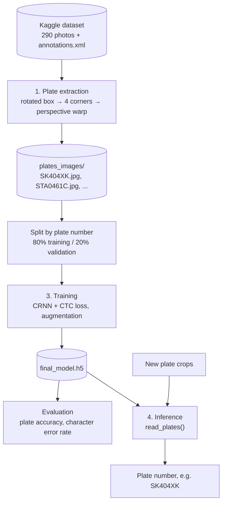
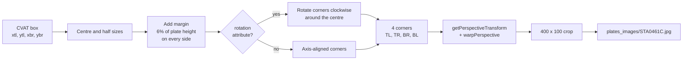
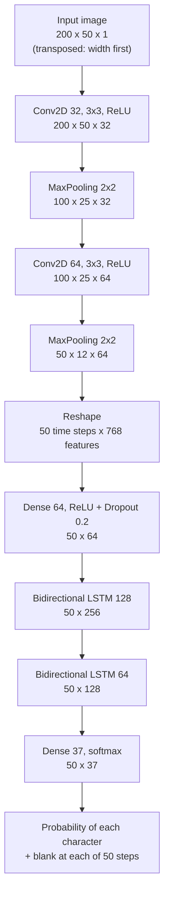
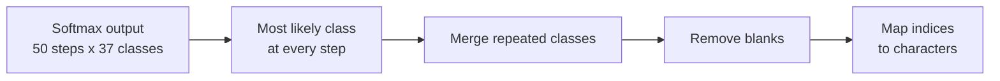
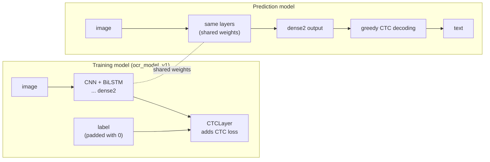
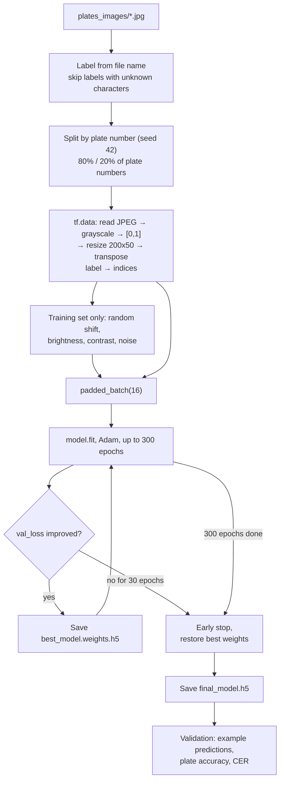
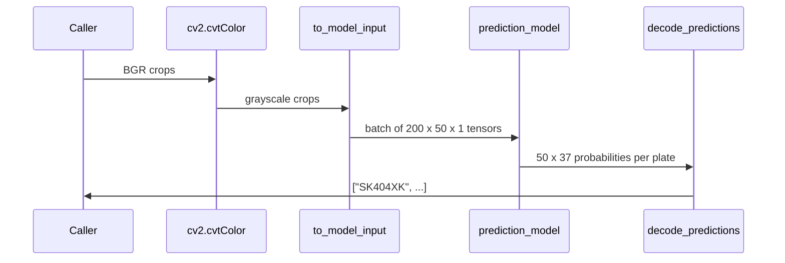

# PlatesOCR

Automatic reading of Polish license plates with OCR. A convolutional-recurrent neural network (CRNN) trained with the CTC loss reads the text of a plate crop.

The whole pipeline, from downloading the dataset to reading plates, is in one notebook: [PlatesOCR.ipynb](PlatesOCR.ipynb).

[](https://colab.research.google.com/github/RBorczuch/PlatesOCR/blob/main/PlatesOCR.ipynb)

## Contents

- [PlatesOCR](#platesocr)
  - [Contents](#contents)
  - [Quick start](#quick-start)
  - [Dataset](#dataset)
  - [Pipeline overview](#pipeline-overview)
  - [1. Plate extraction](#1-plate-extraction)
  - [2. Model](#2-model)
    - [Architecture](#architecture)
    - [Why CTC](#why-ctc)
    - [Training model and prediction model](#training-model-and-prediction-model)
  - [3. Training](#3-training)
  - [4. Inference](#4-inference)
  - [Files and folders](#files-and-folders)
  - [Limitations](#limitations)
  - [Previous version](#previous-version)

## Quick start

**Google Colab.** Open the notebook with the badge above, choose a GPU runtime and run all cells. TensorFlow is already installed there.

**Locally.**

```bash
pip install -r requirements.txt
jupyter notebook PlatesOCR.ipynb
```

Two switches in the first code cell choose what runs:


| Switch           | `True`                                                     | `False`                             |
| ---------------- | ---------------------------------------------------------- | ----------------------------------- |
| `RUN_EXTRACTION` | download the dataset (about 600 MB) and cut out the plates | use the existing`plates_images/`    |
| `RUN_TRAINING`   | train a new model, save it to`final_model.h5`              | load the model from`final_model.h5` |

## Dataset

[Poland vehicle license plate dataset](https://www.kaggle.com/datasets/piotrstefaskiue/poland-vehicle-license-plate-dataset) on Kaggle, collected in Katowice by the University of Economics in Katowice (last updated January 2026).


|             |                                                                                                                    |
| ----------- | ------------------------------------------------------------------------------------------------------------------ |
| Photos      | 290, up to 4640 x 2088 px                                                                                          |
| Annotations | `annotations.xml` in CVAT 1.1 format: one box per plate (26 of them rotated) with the plate number as an attribute |
| Plates      | 290 annotations, 267 different plate numbers, mostly 7 or 8 characters                                             |
| Conditions  | sun, clouds, winter, dirty and snowy plates, glare, different angles and distances                                 |
| Download    | public, no Kaggle account needed                                                                                   |

## Pipeline overview



The model reads plates that are already cut out and straightened. In the dataset the plates are located by the annotations; for new photos a plate detector is needed in front of the model.

## 1. Plate extraction

Each annotation in `annotations.xml` looks like this:

```xml
<image id="3" name="101.jpg" width="2284" height="1522">
  <box label="plate" xtl="1268.64" ytl="679.43" xbr="1631.55" ybr="790.41" rotation="3.70">
    <attribute name="plate number">STA0461C</attribute>
  </box>
</image>
```

Every box is turned into a flat `400 x 100` image named after the plate number:



- The margin makes sure that characters touching the edge of a tight box are not cut off.
- CVAT stores rotation in degrees, clockwise around the box centre. Applying it before the warp straightens tilted plates.
- Spaces in plate numbers are removed (`SB 262FF` → `SB262FF`). The same plate in a second photo is saved as `SB262FF__2.jpg`.

There is no colour filtering or thresholding. An earlier version of this project masked out everything but dark pixels. On this dataset that erased characters on faded and dirty plates, so the network now gets plain grayscale images and learns to handle glare, dirt and shadows itself.

## 2. Model

### Architecture

The model is a CRNN: convolutions turn the image into a sequence of feature vectors (one per column of the plate), and recurrent layers read that sequence from left to right and from right to left.



The 37 output classes are the 35 characters in `CHARACTERS` (digits and letters except `Q`, which does not occur in the dataset), the `[UNK]` token of `StringLookup` and the CTC blank. The image is transposed before it enters the network, so after the convolutions each of the 50 time steps corresponds to a 4-pixel-wide vertical strip of the plate.

### Why CTC

A plate has 7 or 8 characters, but the network produces 50 predictions, and the annotations do not say where each character is. Connectionist Temporal Classification (CTC) solves this: the loss sums the probability of every alignment of the 50 steps that reduces to the correct text, so the network learns from the plate number alone.

Reading a plate (greedy decoding) reverses that reduction:



Example with `-` as the blank:

```
step output:   - - S S - K K - 4 - 0 0 - 4 - - X K K - -
merge repeats: - S - K - 4 - 0 - 4 - X K -
remove blanks: S K 4 0 4 X K   →   "SK404XK"
```

Doubled characters on a plate (such as `11` in `SCZ26114`) survive because the network outputs a blank between them.

### Training model and prediction model



- Labels in a batch have different lengths, so they are padded with 0 (the `[UNK]` index, which never appears in a real label). `CTCLayer` counts the non-zero entries to get each label's real length.
- `CTCLayer` computes the loss with `tf.nn.ctc_loss` and adds it with `add_loss`, so the model is compiled without a separate loss function. `tf.nn.ctc_loss` and `tf.nn.ctc_greedy_decoder` work with both Keras 2 (TensorFlow 2.15) and Keras 3 (TensorFlow 2.16 and later).
- The prediction model reuses the layers from the input to `dense2`, so it changes together with the training model and with loaded weights.

## 3. Training



- **Split by plate number.** Some cars appear in more than one photo. All crops of one plate number go to the same subset, so the validation set only contains plates the model has never seen. A random split by image would leak them and make the results look better than they are.
- **Augmentation.** About 230 training images are few for a neural network, which then memorizes the training set. Each epoch, every training image is shifted by a few pixels and gets random brightness, contrast and noise, so the network never sees exactly the same image twice.
- **Metrics.** *Plate accuracy* counts a plate as correct only when every character matches. *Character error rate (CER)* is the number of character edits (Levenshtein distance) between predictions and true plate numbers, divided by the number of true characters. It shows how close the wrong readings are.

With `RUN_TRAINING = False`, `final_model.h5` is loaded with `load_weights` into the same architecture. Loading only the weights avoids rebuilding the custom `CTCLayer` from the file, which is not portable between Keras 2 and Keras 3. If the file was trained with a different `CHARACTERS` list, the notebook stops with an explanation.

## 4. Inference

`read_plates(images)` takes straightened BGR plate crops, such as those produced by `warp_plate()`:



## Files and folders


| Path                    | Contents                                                                          |
| ----------------------- | --------------------------------------------------------------------------------- |
| `PlatesOCR.ipynb`       | the whole pipeline                                                                |
| `requirements.txt`      | Python dependencies for running locally                                           |
| `dataset/`              | unpacked Kaggle dataset:`annotations.xml` and `photos/` (created by the notebook) |
| `plates_images/`        | straightened plate crops, file name = plate number (created by the notebook)      |
| `best_model.weights.h5` | best weights saved during training                                                |
| `final_model.h5`        | trained model; the committed one is outdated, see[Quick start](#quick-start)      |

## Limitations

- **Small dataset.** 290 photos, 267 different plates. Expect mistakes on unusual plates (custom plates, old black plates, temporary plates). More data helps most. Other Polish datasets, such as Roboflow Universe collections, can be added if they are converted to the `plates_images/` naming scheme.
- **One-row plates only.** Two-row plates (motorcycles, some trailers) do not fit the left-to-right reading of the model.
- **Fixed character set.** A trained model only fits the `CHARACTERS` list it was trained with.

## Previous version

The first version of this project was trained on different data: a license plate dataset from Roboflow Universe, exported in COCO format with a segmentation polygon around every plate. The plates were cut out of the photos, labelled automatically with EasyOCR and corrected by hand, which gave a training set of 250 plates. 

The Roboflow export link used by the notebooks has since expired (the download returns HTTP 403), so the dataset could no longer be downloaded. In this update it was replaced with the [Poland vehicle license plate dataset](#dataset) from Kaggle. Because that dataset already contains the plate numbers, the EasyOCR labelling and manual review steps were removed as well. The original three notebooks (`license_plates_extraction.ipynb`, `PlatesOCR_learning.ipynb`, `PlatesOCR_model_test.ipynb`) are still available in the git history.
