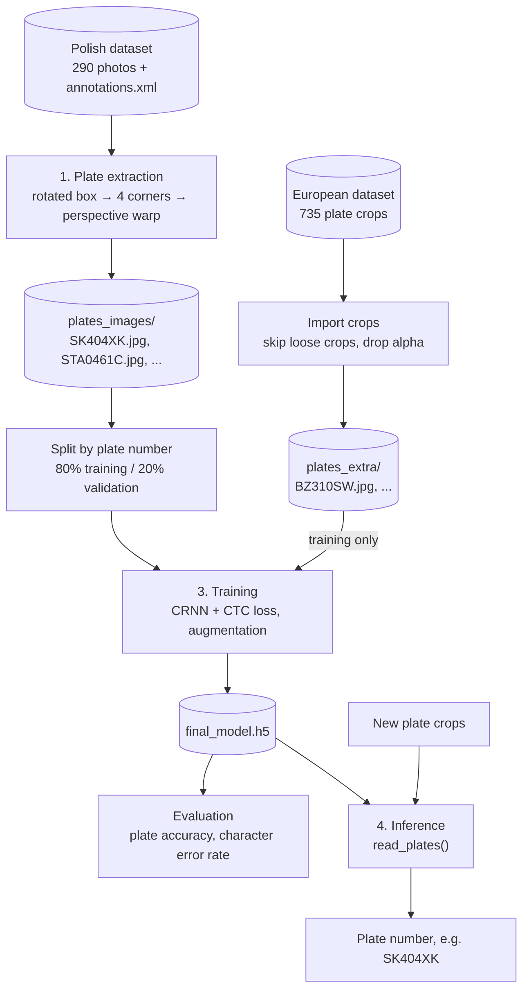
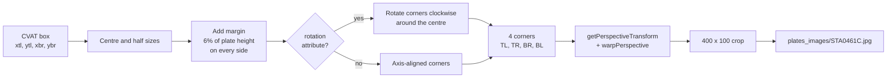
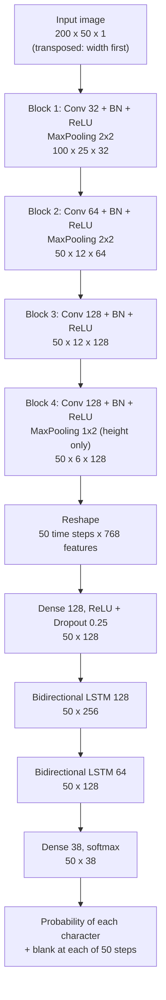
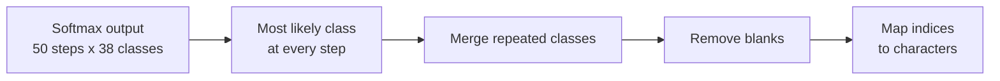
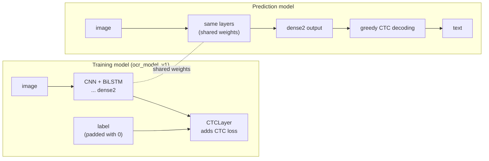
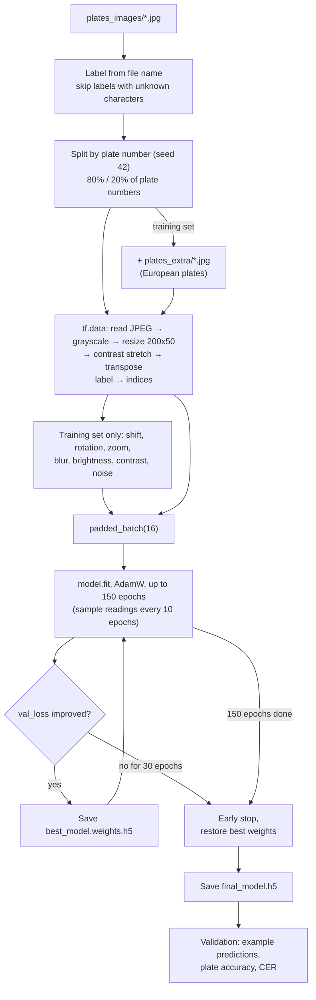
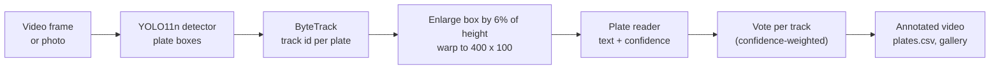
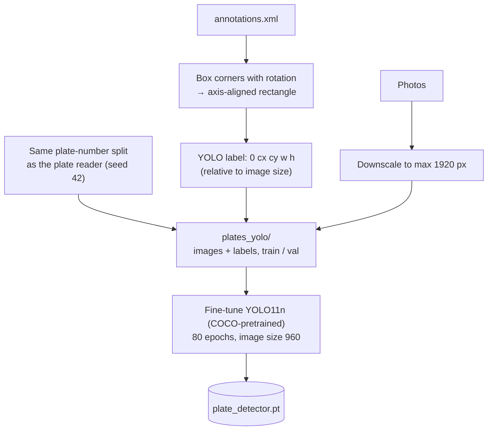
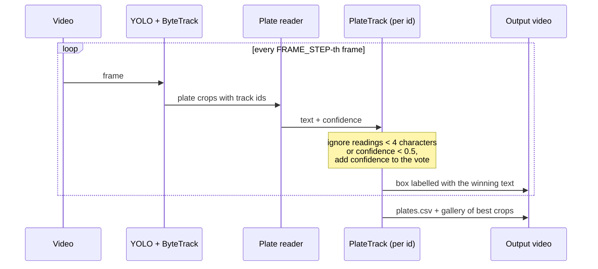

# PlatesOCR

Automatic reading of Polish license plates with OCR. A convolutional-recurrent neural network (CRNN) trained with the CTC loss reads the text of a plate crop.

The project has two notebooks:

| Notebook | What it does | |
|---|---|---|
| [PlatesOCR.ipynb](PlatesOCR.ipynb) | downloads the datasets, cuts out the plates and trains the plate reader (OCR) | [](https://colab.research.google.com/github/RBorczuch/PlatesOCR/blob/main/PlatesOCR.ipynb) |
| [PlatesOCR_video.ipynb](PlatesOCR_video.ipynb) | trains a YOLO plate detector and runs detector + plate reader on photos and on a video | [](https://colab.research.google.com/github/RBorczuch/PlatesOCR/blob/main/PlatesOCR_video.ipynb) |

## Contents

- [PlatesOCR](#platesocr)
  - [Contents](#contents)
  - [Quick start](#quick-start)
  - [Datasets](#datasets)
  - [Pipeline overview](#pipeline-overview)
  - [1. Plate extraction](#1-plate-extraction)
  - [2. Model](#2-model)
    - [Architecture](#architecture)
    - [Why CTC](#why-ctc)
    - [Training model and prediction model](#training-model-and-prediction-model)
  - [3. Training](#3-training)
  - [4. Inference](#4-inference)
  - [5. Video application: YOLO detector + plate reader](#5-video-application-yolo-detector--plate-reader)
  - [Files and folders](#files-and-folders)
  - [Limitations](#limitations)
  - [Previous version](#previous-version)

## Quick start

**Google Colab.** Open the notebook with the badge above, choose a GPU runtime and run all cells. TensorFlow is already installed there.

**Locally.**

```bash
pip install -r requirements.txt
jupyter notebook PlatesOCR.ipynb
```

Two switches in the first code cell choose what runs:


| Switch           | `True`                                                     | `False`                             |
| ---------------- | ---------------------------------------------------------- | ----------------------------------- |
| `RUN_EXTRACTION` | download the datasets (about 630 MB) and cut out the plates | use the existing `plates_images/` and `plates_extra/` |
| `USE_EXTRA_DATA` | add the European plates to the training set                 | train on the Polish plates only                       |
| `RUN_TRAINING`   | train a new model, save it to `final_model.h5`              | load the model from `final_model.h5`                  |

## Datasets

### Polish plates (training and validation)

[Poland vehicle license plate dataset](https://www.kaggle.com/datasets/piotrstefaskiue/poland-vehicle-license-plate-dataset) on Kaggle, collected in Katowice by the University of Economics in Katowice (last updated January 2026).


|             |                                                                                                                    |
| ----------- | ------------------------------------------------------------------------------------------------------------------ |
| Photos      | 290, up to 4640 x 2088 px                                                                                          |
| Annotations | `annotations.xml` in CVAT 1.1 format: one box per plate (26 of them rotated) with the plate number as an attribute |
| Plates      | 290 annotations, 267 different plate numbers, mostly 7 or 8 characters                                             |
| Conditions  | sun, clouds, winter, dirty and snowy plates, glare, different angles and distances                                 |
| Download    | public, no Kaggle account needed                                                                                   |

### European plates (extra training data)

[European License Plates Dataset](https://www.kaggle.com/datasets/abdelhamidzakaria/european-license-plates-dataset) on Kaggle (MIT license).

|           |                                                                                                   |
| --------- | ------------------------------------------------------------------------------------------------- |
| Images    | 735 plate crops (PNG and JPG) from France, Germany, Croatia, Poland and other countries           |
| Labels    | file name = plate number, `_1`, `_2`, ... for repeated plates                                     |
| Used      | 685 crops; 50 loose crops narrower than 2:1 (a lot of background) are skipped                     |
| Download  | public, no Kaggle account needed                                                                  |

With only 231 Polish training images, the network learned the common region prefixes (`KR`, `SB`, `KOL`) but lost the random characters in the middle of the plate. The European crops are added to the training set only, so the network sees more shapes of every character while the validation set stays Polish.

## Pipeline overview



The plate reader reads plates that are already cut out and straightened. In the dataset the plates are located by the annotations; for photos and videos, the YOLO detector in `PlatesOCR_video.ipynb` finds them (see [section 5](#5-video-application-yolo-detector--plate-reader)).

## 1. Plate extraction

Each annotation in `annotations.xml` looks like this:

```xml
<image id="3" name="101.jpg" width="2284" height="1522">
  <box label="plate" xtl="1268.64" ytl="679.43" xbr="1631.55" ybr="790.41" rotation="3.70">
    <attribute name="plate number">STA0461C</attribute>
  </box>
</image>
```

Every box is turned into a flat `400 x 100` image named after the plate number:



- The margin makes sure that characters touching the edge of a tight box are not cut off.
- CVAT stores rotation in degrees, clockwise around the box centre. Applying it before the warp straightens tilted plates.
- Spaces in plate numbers are removed (`SB 262FF` → `SB262FF`). The same plate in a second photo is saved as `SB262FF__2.jpg`.

There is no colour filtering or thresholding. An earlier version of this project masked out everything but dark pixels. On this dataset that erased characters on faded and dirty plates, so the network now gets grayscale images and learns to handle glare, dirt and shadows itself. The only normalization is a contrast stretch: the darkest pixel of each plate becomes 0 and the brightest 1, so dark and bright photos look alike.

## 2. Model

### Architecture

The model is a CRNN: convolutions turn the image into a sequence of feature vectors (one per column of the plate), and recurrent layers read that sequence from left to right and from right to left.



The 38 output classes are the 36 characters in `CHARACTERS` (digits and letters `A`-`Z`), the `[UNK]` token of `StringLookup` and the CTC blank. All convolutions are 3x3. The image is transposed before it enters the network, so after the convolutions each of the 50 time steps corresponds to a 4-pixel-wide vertical strip of the plate. The last pooling shrinks only the height, which keeps 50 time steps for 7-8 characters.

An earlier version used only two convolution layers (32 and 64 filters) without batch normalization. That was enough for black-and-white thresholded images, but on real grayscale photos the network never got past the CTC plateau (see [3. Training](#3-training)): it answered `SK` for every plate.

### Why CTC

A plate has 7 or 8 characters, but the network produces 50 predictions, and the annotations do not say where each character is. Connectionist Temporal Classification (CTC) solves this: the loss sums the probability of every alignment of the 50 steps that reduces to the correct text, so the network learns from the plate number alone.

Reading a plate (greedy decoding) reverses that reduction:



Example with `-` as the blank:

```
step output:   - - S S - K K - 4 - 0 0 - 4 - - X K K - -
merge repeats: - S - K - 4 - 0 - 4 - X K -
remove blanks: S K 4 0 4 X K   →   "SK404XK"
```

Doubled characters on a plate (such as `11` in `SCZ26114`) survive because the network outputs a blank between them.

### Training model and prediction model



- Labels in a batch have different lengths, so they are padded with 0 (the `[UNK]` index, which never appears in a real label). `CTCLayer` counts the non-zero entries to get each label's real length.
- `CTCLayer` computes the loss with `tf.nn.ctc_loss` and adds it with `add_loss`, so the model is compiled without a separate loss function. `tf.nn.ctc_loss` and `tf.nn.ctc_greedy_decoder` work with both Keras 2 (TensorFlow 2.15) and Keras 3 (TensorFlow 2.16 and later).
- The prediction model reuses the layers from the input to `dense2`, so it changes together with the training model and with loaded weights.

## 3. Training



- **Split by plate number.** Some cars appear in more than one photo. All crops of one plate number go to the same subset, so the validation set only contains plates the model has never seen. A random split by image would leak them and make the results look better than they are.
- **Augmentation.** A small training set is easy to memorize: on the Polish plates alone the training loss fell below 1 while the validation loss went back up to 13. Every time a training image is used, it is shifted by a few pixels, rotated by up to about 3 degrees, zoomed out by up to 15%, blurred, and gets random brightness, contrast and noise, so the network never sees exactly the same image twice. Zoom only goes out, so characters at the edges are never cut off.
- **Epoch size.** A training set smaller than `IMAGES_PER_EPOCH` (1000) is repeated within an epoch, each time with new augmentation. With the Polish plates alone (231 images) an epoch would otherwise be only 15 batches, and early stopping could end training before the model has had enough steps to learn.
- **Weight decay.** The AdamW optimizer (`WEIGHT_DECAY = 0.01`) slowly shrinks all weights towards zero, which also works against memorizing.
- **CTC plateau.** The loss first drops quickly, then stays around 15-20 for a while: the network only outputs the most common characters (here usually `S` or `SK`, the Silesian prefixes). When it starts to read the characters, the loss falls steeply. A callback prints a few validation readings every 10 epochs, so this moment is easy to see.
- **Metrics.** *Plate accuracy* counts a plate as correct only when every character matches. *Character error rate (CER)* is the number of character edits (Levenshtein distance) between predictions and true plate numbers, divided by the number of true characters. It shows how close the wrong readings are.

With `RUN_TRAINING = False`, `final_model.h5` is loaded with `load_weights` into the same architecture. Loading only the weights avoids rebuilding the custom `CTCLayer` from the file, which is not portable between Keras 2 and Keras 3. If the file was trained with a different `CHARACTERS` list, the notebook stops with an explanation.

## 4. Inference

`read_plates(images)` takes straightened BGR plate crops, such as those produced by `warp_plate()`:

```mermaid
sequenceDiagram
    participant U as Caller
    participant G as cv2.cvtColor
    participant T as to_model_input
    participant M as prediction_model
    participant D as decode_predictions
    U->>G: BGR crops
    G->>T: grayscale crops
    T->>M: batch of 200 x 50 x 1 tensors
    M->>D: 50 x 38 probabilities per plate
    D->>U: ["SK404XK", ...]
```



## 5. Video application: YOLO detector + plate reader

`PlatesOCR_video.ipynb` turns the plate reader into a complete system that works on whole photos and videos. It needs the trained `final_model.h5` (downloaded from this repository if it is missing).



### Detector training

The detector is trained on the boxes of the Katowice dataset:



- **YOLO11n** is the smallest YOLO11 model (about 2.6 million parameters). Starting from COCO weights, a few hundred photos are enough to learn a single class.
- **Image size 960** instead of the default 640, because plates are small in the full photos.
- **Same split as the plate reader.** The plate numbers are split with the same function and seed as in `PlatesOCR.ipynb`, so the validation photos are new to both models.

### Photo test

All validation photos go through the complete system, and the results are compared with the annotations:

| Measure | Meaning |
|---|---|
| mAP50, mAP50-95 | standard detection quality of YOLO on the validation photos |
| detection recall | share of annotated plates found (overlap with the true box at least 50%) |
| false detections | boxes that match no annotated plate |
| end-to-end accuracy | share of annotated plates found *and* read without a mistake |
| CER | character error rate of the readings of the found plates |

This is the most honest measure of the whole system, because the crops come from the detector, not from the annotations.

### Video



- **Tracking.** ByteTrack links the boxes of one car across frames, so its readings can be combined.
- **Confidence.** For each reading, the probability of the least certain character. One unreadable character is enough to make it low.
- **Vote.** One frame can be blurred or partly hidden. Each track sums the confidences of its readings per text; the text with the highest sum is the plate of that track, labelled in the video with its share of the vote.
- **Output.** `video_output/<name>_annotated.mp4` (converted to H.264 with `ffmpeg` so that browsers can play it), `video_output/plates.csv` with one row per plate (reading, share of the vote, number of frames, time visible) and a gallery of the most confident crop of each plate.

Best results come from 1080p video of Polish one-row plates, at least about 100 px wide in the frame, in daylight and with little motion blur.

## Files and folders


| Path                    | Contents                                                                          |
| ----------------------- | --------------------------------------------------------------------------------- |
| `PlatesOCR.ipynb`       | datasets, plate extraction and training of the plate reader                       |
| `PlatesOCR_video.ipynb` | YOLO plate detector, photo test and video application                             |
| `requirements.txt`      | Python dependencies for running locally                                           |
| `dataset/`              | unpacked Kaggle dataset:`annotations.xml` and `photos/` (created by the notebook) |
| `plates_images/`        | straightened plate crops, file name = plate number (created by the notebook)      |
| `dataset_eu/`           | unpacked European dataset (created by the notebook)                               |
| `plates_extra/`         | European plate crops, file name = plate number (created by the notebook)          |
| `best_model.weights.h5` | best weights saved during training                                                |
| `final_model.h5`        | trained plate reader (38 classes)                                                 |
| `plates_yolo/`          | detector training data in YOLO format (created by the video notebook)             |
| `plate_detector.pt`     | trained YOLO plate detector (created by the video notebook)                       |
| `video_output/`         | annotated video, `plates.csv` (created by the video notebook)                     |

## Limitations

- **Small dataset.** 290 Polish photos (267 different plates) plus 685 European crops. Expect mistakes on unusual plates (custom plates, old black plates, temporary plates). More data helps most: any folder of crops named `<plate number>.jpg` can be added to the training set the same way as `plates_extra/`. Synthetic plates (random plate numbers rendered in the plate font) are the next step if real data runs out.
- **One-row plates only.** Two-row plates (motorcycles, some trailers) do not fit the left-to-right reading of the model.
- **Fixed character set.** A trained model only fits the `CHARACTERS` list it was trained with.

## Previous version

The first version of this project was trained on different data: a license plate dataset from Roboflow Universe, exported in COCO format with a segmentation polygon around every plate. The plates were cut out of the photos, labelled automatically with EasyOCR and corrected by hand, which gave a training set of 250 plates. 

The Roboflow export link used by the notebooks has since expired (the download returns HTTP 403), so the dataset could no longer be downloaded. In this update it was replaced with the [Poland vehicle license plate dataset](#polish-plates-training-and-validation) from Kaggle. Because that dataset already contains the plate numbers, the EasyOCR labelling and manual review steps were removed as well. The original three notebooks (`license_plates_extraction.ipynb`, `PlatesOCR_learning.ipynb`, `PlatesOCR_model_test.ipynb`) are still available in the git history.
